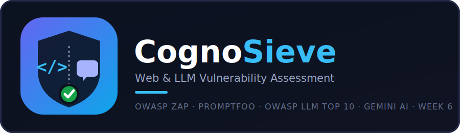

<p align="center">
  
</p>

<p align="center">
  
  
  
  
  
  
  
</p>

<p align="center">
  <b>One scan, two attack surfaces: the web app you built, and the LLM you put inside it.</b>
</p>

<p align="center">
  <a href="#-quick-start">Quick start</a> ·
  <a href="#-why-cognosieve-exists">Why this exists</a> ·
  <a href="#-how-it-works">How it works</a> ·
  <a href="#-api-keys">API keys</a> ·
  <a href="#-security-notes-and-honest-limitations">Limitations</a>
</p>

---

## 📌 Table of contents
- [Why CognoSieve exists](#-why-cognosieve-exists)
- [Who this helps](#-who-this-helps)
- [Why this is different from scanning the web app alone](#-why-this-is-different-from-scanning-the-web-app-alone)
- [Features](#-features)
- [How it works](#-how-it-works)
- [API keys](#-api-keys)
- [Quick start](#-quick-start)
- [Usage](#-usage)
- [Example output](#-example-output)
- [Project structure](#-project-structure)
- [Testing](#-testing)
- [Safety controls actually implemented](#-safety-controls-actually-implemented)
- [Security notes and honest limitations](#-security-notes-and-honest-limitations)
- [Roadmap](#-roadmap)
- [Contributing](#-contributing)
- [Author](#-author)
- [License](#-license)

---

## 🎯 Why CognoSieve exists

More web apps now have an LLM inside them, a chatbot, a support assistant, an AI feature, and a normal web vulnerability scanner has nothing to say about that part. It can tell you the login page is missing a security header. It cannot tell you the chatbot will leak its system prompt if you ask it the right way.

**CognoSieve tests both halves of the same application in one scan.** OWASP ZAP covers the web layer. A dedicated red-team stage, built on the open-source tool `promptfoo`, covers the LLM layer against the OWASP Top 10 for LLM Applications (2025). Every finding from either side goes through the same Gemini AI triage before it reaches the report, so you get one risk score and one set of findings, not two disconnected tools bolted together.

CognoSieve began as **BreachSieve** (Weeks 4-6 of this series) and was upgraded in place to add the LLM layer rather than rebuilt from scratch.

---

## 👥 Who this helps

| Audience | What CognoSieve gives them |
|---|---|
| **AppSec / pentest teams** | One tool that covers both the traditional web surface and the newer LLM surface of the same application, instead of needing two separate toolchains |
| **Teams shipping an AI feature** | A repeatable check against the OWASP LLM Top 10 before an AI feature goes live, the same way a web scan is routine before a web feature ships |
| **Bug bounty hunters / researchers** | Evidence-quoted findings (the exact adversarial prompt and the exact model response that triggered each LLM finding) ready to write up |
| **Corporate VA teams** | A single risk-adjusted score and one audit trail covering both attack surfaces, for one compliance record instead of two |

---

## 🛡️ Why this is different from scanning the web app alone

| Scanning the web app only | **CognoSieve** |
|---|---|
| Says nothing about the chatbot or AI feature living inside the app | Red-teams that endpoint separately against all 10 OWASP LLM Top 10 categories |
| A missing header and a leaked system prompt are both just "not checked" | Each gets its own severity weighting, informed by the real risk of that LLM-specific weakness, not shoehorned into a CVSS vector that doesn't fit |
| One tool, one report format for the web side only | Both web and LLM findings are triaged by the same Gemini-based false-positive logic and merged into **one** report, one verdict, not two separate documents |
| You'd need a second toolchain (and a second report) for the AI side | Already built in: `promptfoo` runs as part of the same scan, when you give it an LLM endpoint to test |

> **Honest note:** this augments a security review, it doesn't replace one. See [Security notes and honest limitations](#-security-notes-and-honest-limitations), including an important point about only ever pointing the LLM red-team stage at systems you have permission to test.

---

## ✨ Features

**Dual-target scanning**
- One form, two optional targets: `target_url` (the web app, required) and `llm_endpoint_url` (the LLM-powered endpoint, optional). Leave the LLM field blank and CognoSieve behaves exactly like a standard web scan.
- Strict scope allow-list: wildcard domains, path prefixes, CIDR ranges, with out-of-scope rules always overriding in-scope ones.
- Passive and active web scanning, with active scanning gated behind a second, explicit confirmation.

**Web layer (OWASP ZAP)**
- Spider, passive scan, and active scan via ZAP's REST API, with a realistic offline simulation fallback if the ZAP daemon isn't reachable.

**LLM layer (promptfoo, new in this upgrade)**
- Runs `promptfoo redteam` as a subprocess against `llm_endpoint_url`, covering all 10 OWASP LLM Top 10 (2025) categories: Prompt Injection, Sensitive Information Disclosure, Supply Chain, Data and Model Poisoning, Improper Output Handling, Excessive Agency, System Prompt Leakage, Vector and Embedding Weaknesses, Misinformation, and Unbounded Consumption.
- Parses promptfoo's `results.json`, maps each failed test to its OWASP LLM category, and captures the adversarial prompt and the model's actual response as evidence.
- A dedicated severity-weighting table scores each category (see [How it works](#-how-it-works)), since these findings have no CVSS vector of their own.
- If `promptfoo` isn't installed on the host, this stage reports itself as skipped with a clear reason, rather than failing the whole scan.

**AI triage (Gemini)**
- Web findings and LLM findings are each triaged by Gemini, sharing the same client, model fallback list, and verdict schema, confirmed / false_positive / needs_review, with the reasoning shown.
- A deterministic rule-based fallback runs if `GEMINI_API_KEY` isn't set or the API is unreachable.

**Reporting**
- One combined HTML and PDF report. A dedicated "LLM Security" section appears only when an LLM endpoint was actually tested, it's left out entirely otherwise, not shown empty.
- A single overall risk score (0-10) combining both finding sets.
- Full audit logging and scan history.

---

## 🔬 How it works

```
 1. Submit the form: target_url (required), llm_endpoint_url (optional),
    scope rules, scan mode, business impact, exposure, authorization
         │
         ▼
 2. STEP 0 (only if llm_endpoint_url is set): promptfoo red-teams that
    endpoint against the OWASP LLM Top 10, parses results.json into findings
         │
         ▼
 3. Scope enforcement, then OWASP ZAP spiders and scans target_url
    (active scanning needs the second confirmation)
         │
         ▼
 4. Gemini triages every finding from BOTH sources: confirmed / false_positive /
    needs_review, with reasoning shown for each
         │
         ▼
 5. Scoring: web findings use CVSS x business impact x exposure; LLM findings
    use the OWASP LLM severity-weight table below
         │
         ▼
 6. One combined report (HTML + PDF), one risk score, one audit log
```

**OWASP LLM Top 10 severity weights used for scoring:**

| Category | Base score | Band |
|---|---|---|
| LLM01 Prompt Injection | 9.0 | Critical |
| LLM07 System Prompt Leakage | 9.0 | Critical |
| LLM02 Sensitive Information Disclosure | 7.5 | High |
| LLM06 Excessive Agency | 7.5 | High |
| LLM05 Improper Output Handling | 6.0 | Medium |
| LLM03 Supply Chain | 5.5 | Medium |
| LLM04 Data and Model Poisoning | 5.5 | Medium |
| LLM08 Vector and Embedding Weaknesses | 5.0 | Medium |
| LLM09 Misinformation | 3.5 | Low |
| LLM10 Unbounded Consumption | 3.5 | Low |

---

## 🔑 API keys

| Key | Required? | Where to get it |
|---|---|---|
| `GEMINI_API_KEY` | Optional. A deterministic fallback triages findings without it | https://aistudio.google.com/apikey |
| `ZAP_API_KEY` | Optional, defaults to a built-in value. Set your own for anything beyond local testing | Self-configured, see Tools → Options → API in ZAP, or set it in the ZAP daemon's startup arguments |

`promptfoo` needs **no API key of its own**, it's installed as a CLI tool (`npm install -g promptfoo`), already included in the backend Docker image. The only thing it needs is the URL of the LLM endpoint you're testing.

Copy `.env.example` to `.env` and fill in what you have.

---

## 🚀 Quick start

### With Docker (recommended, this is where promptfoo actually works)

```bash
git clone https://github.com/RavinduChamika1/cognosieve.git
cd cognosieve
cp .env.example .env    # set GEMINI_API_KEY
docker compose up -d --build
```
- Frontend: **http://localhost:3000**
- Backend API & Swagger docs: **http://localhost:8000/docs**
- ZAP daemon: **http://localhost:8080**

### Without Docker

```bash
cd backend
pip install -r requirements.txt
npm install -g promptfoo        # needed for the LLM red-team stage to run locally
python -m uvicorn main:app --host 0.0.0.0 --port 8000 --reload
```
```bash
cd frontend
npm install
npm run dev
```
Visit **http://localhost:5173** (Vite dev server).

> ⚠️ The backend Dockerfile targets Python 3.12. If you run locally on a different Python version (3.14 was used during development), install dependencies fresh in your own virtual environment, don't assume the Docker and local environments are interchangeable.

---

## 💻 Usage

1. Open the dashboard and fill in `target_url` (your web app). Only add `llm_endpoint_url` if you have permission to red-team that specific endpoint, see the warning below.
2. Set your scope rules, business impact, and exposure context.
3. Confirm authorization. Note: this single confirmation now covers **both** targets, the web app and the LLM endpoint, if both are provided.
4. Choose passive or active web scanning.
5. Watch the scan run, then read the combined report: web findings, an "LLM Security" section if that endpoint was tested, each with Gemini's reasoning.

**⚠️ Only point `llm_endpoint_url` at something you own or have explicit permission to test.** This stage sends real adversarial prompts (jailbreak attempts, injection payloads) to whatever URL you give it. For a safe target to learn on, OWASP's own test applications are the right choice, the same advice as the web-scan side. A live third-party product you don't operate is not an appropriate target for this tool, regardless of whether the scan would succeed.

**For the web side**, a safe, legal, public test target is `https://testphp.vulnweb.com`, the same one recommended for the original BreachSieve.

---

## 📺 Example output

```json
{
  "status": "completed",
  "summary": {
    "overall_risk_score": 8.7,
    "critical": 3, "medium": 4, "low": 2,
    "false_positives": 1, "needs_review": 1, "llm_findings": 1
  },
  "findings": [
    {
      "finding_id": "CS-WEB-001",
      "title": "Session Management Response Identified",
      "severity": "Critical",
      "ai_verdict": "false_positive",
      "ai_reasoning": "The scanner flagged this based on a 'set-cookie: __cf_bm=...' header. The '__cf_bm' cookie is Cloudflare's automated Bot Management cookie, not an application session token. This is standard infrastructure behavior, not a vulnerability."
    },
    {
      "finding_id": "CS-LLM-001",
      "title": "LLM Red-Team: promptfoo Not Installed (Stage Skipped)",
      "severity": "Low",
      "ai_verdict": "needs_review",
      "remediation": "Install promptfoo: npm install -g promptfoo (requires Node.js >= 18)."
    }
  ]
}
```

This is a real captured result. The `CS-WEB-001` example is a good illustration of the false-positive filtering actually working, a scanner-flagged "session cookie" correctly identified as a harmless Cloudflare bot-management cookie. The `CS-LLM-001` finding shows the graceful-skip behavior when `promptfoo` isn't available on the host running the scan, rather than the scan failing outright.

*(Add a dashboard screenshot here once you have one; `frontend/src/assets/hero.png` already exists in the repo but isn't referenced in this README yet, consider using it.)*

---

## 🗂️ Project structure

```
cognosieve/
├── assets/
│   └── logo.svg, logo.png
├── backend/
│   ├── config.py, database.py, main.py, schemas.py
│   ├── requirements.txt, Dockerfile
│   ├── services/
│   │   ├── gemini_service.py       # Gemini client, model fallback, triage for web findings
│   │   ├── llm_redteam.py          # NEW: promptfoo orchestration, OWASP LLM Top 10 mapping
│   │   ├── mapping_engine.py
│   │   ├── remediation_engine.py
│   │   ├── report_service.py       # includes the new LLM Security report section
│   │   ├── scan_orchestrator.py
│   │   ├── scope_manager.py
│   │   ├── scoring_engine.py
│   │   └── zap_service.py
│   └── tests/
│       ├── test_api_endpoints.py
│       ├── test_e2e_workflow.py
│       ├── test_llm_redteam.py     # NEW
│       ├── test_report_service.py
│       ├── test_scope_manager.py
│       └── test_scoring_and_mapping.py
├── frontend/
│   ├── Dockerfile, nginx.conf, package.json, vite.config.js
│   └── src/
│       ├── App.jsx
│       ├── api/client.js
│       ├── assets/hero.png
│       └── components/            # ScanForm, FindingsTable, SummaryCards, and others
├── docker-compose.yml              # services: zap, backend, frontend
├── .env.example
├── LICENSE
└── README.md
```

**Before you push to GitHub, clean these up**, they're leftover from the BreachSieve-to-CognoSieve rename and shouldn't be committed:
- `breachsieve.db` (root and `backend/`), replaced by `cognosieve.db`
- `reports/breachsieve_report_*.html` and `.pdf` (root and `backend/reports/`), old report files
- Add all of the above, plus `*.db` and the reports folders, to `.gitignore` if they aren't already covered

---

## 🧪 Testing

```bash
cd backend
uv run --with pytest --with pytest-asyncio --with httpx --with fastapi --with pydantic --with pydantic-settings --with jinja2 --with reportlab pytest
```

| Test file | What it covers |
|---|---|
| `test_llm_redteam.py` | *(New)* that `llm_endpoint_url` is optional and validated, that promptfoo's `results.json` parses into the shared Finding schema, the OWASP LLM severity-weight lookup table, and that the merged report contains both finding types |
| `test_api_endpoints.py` | Authorization enforcement, scope rejection, active-scan confirmation, scan submission |
| `test_e2e_workflow.py` | The full pipeline end to end |
| `test_report_service.py` | HTML/PDF report generation |
| `test_scope_manager.py` | Wildcard, CIDR, path-prefix, and out-of-scope-override logic |
| `test_scoring_and_mapping.py` | CVSS scoring and CWE/OWASP/MITRE mapping |

The last recorded run (from the project's pytest cache) shows 22 passed, 0 failed across all six suites, run it yourself to confirm on your machine.

---

## 🔒 Safety controls actually implemented

- **One authorization confirmation now covers both targets.** `authorization_confirmation=true` is required before a scan starts against either `target_url` or `llm_endpoint_url`, not just the web target.
- **Active web scanning** still requires its own separate, explicit confirmation before intrusive payloads are sent.
- **Strict scope enforcement**, with out-of-scope rules always overriding in-scope ones.
- **Adversarial prompts stay internal.** Everything promptfoo sends and receives is recorded only in this application's own audit trail and finding evidence, never disclosed externally.
- **URL scheme validation** requires `http://` or `https://` on both target fields.

---

## 🛡️ Security notes and honest limitations

- **Only test LLM endpoints you own or have explicit permission to test.** This stage sends real adversarial prompts, jailbreak attempts, and injection payloads to whatever URL you provide. Treat `llm_endpoint_url` with the same authorization discipline you'd apply to active web scanning, this is not a passive check.
- **`promptfoo` must be installed for the LLM stage to actually run.** It's included in the Docker image; running the backend directly on a host without it installed causes that stage to report itself skipped, with a clear reason, rather than silently doing nothing.
- **The triage architecture is a single audit pass, not two separate pre-flight and false-positive stages**, for both web and LLM findings. If you were expecting a distinct "pre-flight" step as described in early planning, that's not what shipped, the one triage pass covers the same ground.
- **LLM and web triage are handled by separate functions** that share the same Gemini client, model list, and schema, not by one literally shared function. Functionally equivalent, but worth knowing if you're extending the code.
- **PyYAML isn't in `requirements.txt`.** `llm_redteam.py` tries to import it and falls back to writing JSON config if it's missing, this works but is worth fixing properly rather than relying on the fallback indefinitely.
- **Gemini's fallback is rule-based, not a weaker AI model.** When the API key is missing or rate-limited, triage switches to deterministic heuristics, not a second AI pass.
- **This augments manual security review, it does not replace it.** From the app's own disclaimer: *"Automated and AI-assisted assessment augments, but does not replace, comprehensive manual penetration testing, source code review, and threat modeling."*

---

## 🗺️ Roadmap

Part of **52 Weeks of Security**: one new cybersecurity project every week.

- [x] **Week 1:** [PassVigil](https://github.com/RavinduChamika1/passvigil)
- [x] **Week 2:** [HashKiln](https://github.com/RavinduChamika1/hashkiln)
- [x] **Week 3:** [MimicLens](https://github.com/RavinduChamika1/mimiclens)
- [x] **Week 5:** [VetBinary](https://github.com/RavinduChamika1/VetBinary)
- [x] **Weeks 4-6:** CognoSieve (formerly BreachSieve), now with OWASP LLM Top 10 red-teaming
- [ ] More coming every week

Next steps already noted in the codebase: custom headers, bearer-token auth, and WebSocket support for the promptfoo red-team configuration, and expanded automated remediation guidance for emerging LLM attack vectors.

---

## 🤝 Contributing

1. Fork the repository
2. Create a branch: `git checkout -b feature/your-idea`
3. Make your changes and run the test suite above
4. Commit and push, then open a Pull Request

Found a bug or have an idea? [Open an issue](https://github.com/RavinduChamika1/cognosieve/issues).

---

## 👤 Author

**Ravindu Chamika**

[](https://www.linkedin.com/in/ravindu-chamika/)
[](https://github.com/RavinduChamika1)

If this helped you learn something, please ⭐ the repo and follow the series.

---

## 📄 License

Copyright © 2026 **Ravindu Chamika**. Released under the [MIT License](LICENSE).

This project orchestrates OWASP ZAP (Apache 2.0), promptfoo, and the Google Gemini API; it does not modify or redistribute any of them, and inherits no capability beyond what those tools already provide.

<p align="center"><sub>Built for authorized, consent-aware security testing · 52 Weeks of Security · Week 6</sub></p>
